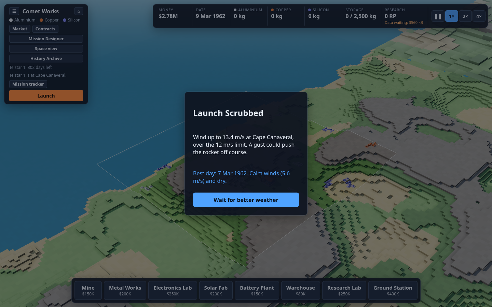

# 16: Real places and weather

**What to build:** Players pick their start on a globe (Historic pin at JPL, anywhere in the US, anywhere on Earth, or Random). Real NASA POWER climate shapes the Site, latitude changes launch performance, weather can Scrub launches, and a Launch Window advisor suggests the best day.

**Blocked by:** 03, 08

**Status:** built, waiting for a team test

- [x] Globe picker offers Historic start, US, Anywhere (labelled alternate history) and Random
- [x] Climate (sunshine, wind, rain, temperature) comes from baked NASA POWER 2025 data
- [x] Site terrain and deposits reflect the real land type
- [x] Launch sites nearer the equator give more payload capacity
- [x] Weather over the limits Scrubs the launch with a short explanation
- [x] Launch Window advisor suggests a day and says why

**QA (2026-11-11):** already noted in the handoff; checked again.

- [ ] Pause the Site while the Scrub card is read, then restore its speed when the card closes. Attempt a Launch in bad weather at **1×** and leave the card open. The Game date advanced more than two days in five seconds. The card still recommended **7 March 1962** when the date had reached **9 March**. Reading it can cost the player the suggested Launch day and Contract days.

