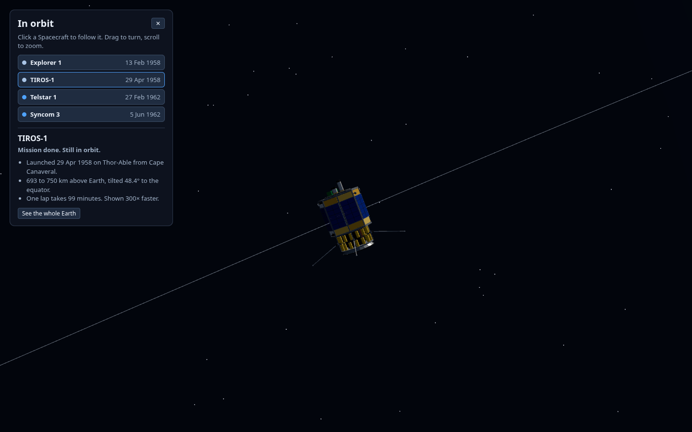

# 31: Space view

**What to build:** Once a Spacecraft is in orbit, the player can open a 3D view of Earth with every Spacecraft the Company has up there, each moving along its real orbit, and click one to follow it.

**Blocked by:** 10

**Status:** done (asked for by the team on 2026-11-09; no earlier ticket covered it)

- [x] A **Space view** button on the HUD once something is in orbit, and **See it in orbit** on the Mission Report when the Spacecraft got there
- [x] Each Spacecraft on its real orbit (size, shape, tilt) moving as Kepler says, sped up, with Earth turning at the same pace
- [x] Click a Spacecraft (in 3D, on its name tag or in the list) to follow its model round the orbit; back to the whole Earth
- [x] Shows what it is doing (sending Data, silent since the Power ran out, Mission done) and its Launch, orbit and lap time
- [x] Mission Reports keep the design that flew (save v8; older reports show a plain model)

**Later:** the Moon, and Spacecraft orbiting the Moon or other worlds, with their Contracts (Era 3 on; Optional in `CHECKLIST.md`).

**QA (2026-11-11):**

- [x] Keep the camera outside Earth while following a Spacecraft. Follow TIROS-1, zoom out, then drag around it towards Earth. The camera can cross Earth's surface; the globe disappears, leaving the Spacecraft and stars visible from inside it. **See the whole Earth** recovers the view.

**Fixed (2026-11-12):** after every camera move the Space view pushes the camera straight back out if it is closer to Earth's centre than 1.05 Earth radii (just above the atmosphere's glow, below Explorer 1's 358 km perigee, the lowest orbit). `src/world/spaceCamera.ts`. Checked in Chromium with the steps above: before the fix the globe vanished; after it, the camera skims the clouds.
