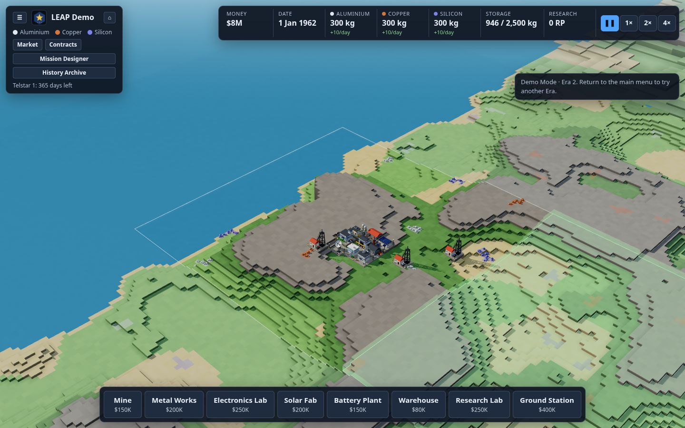
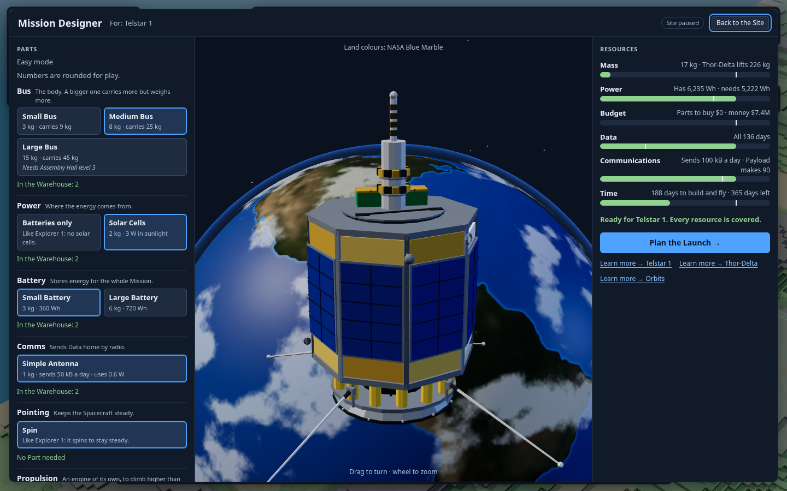

# Features and game

Feature guide for **LEAP**, captured **12 November 2026** from the latest pulled `main`, **3e14a176881e8f42803c43e97d0e058cfea83fcb** (PR #31). Branch: `codex/development-feature-screenshots`. **81 new screenshots**, Chromium 156 at **1440×900**, 1× pixel scale. Click a screenshot link to open the full PNG.

This covers the features built across tickets **01–31**, including the built parts of 27–29. The folder name means before the official challenge Resources are integrated; the game already uses NASA data. Actual Era illustrations, later Campaign Eras and submission work remain unfinished.

Most industry views use the real Era 2 Demo. Mission, Research, progression and land views also use local prepared fixtures so the feature can be shown without waiting through the whole Campaign. The descriptions identify those setups. The normal rules and UI produce the results; game code, tests, save format and deployed services are unchanged.

## Start a Company and choose a mode

From the title, choose **Let’s go**. The main menu opens Company setup, the Demo picker and Online. Setup combines a name, logo, Seed, place, play mode and difficulty.

| Ticket | Screenshot | What it represents |
|---|---|---|
| [26](../../../docs/tickets/26-look-and-feel.md) | [Title screen](ticket-26-title-screen.png) | Original LEAP wordmark, subtitle and acronym over the rendered Site. |
| [24](../../../docs/tickets/24-demo-mode.md) | [Main menu](ticket-24-main-menu.png) | Start or Continue, Demo Mode, Online, shared Seed setup and Credits. |
| [24](../../../docs/tickets/24-demo-mode.md) | [Demo picker](ticket-24-demo-era-picker.png) | Ready Companies for Era 1 and Era 2; selecting either starts that demo afresh. |
| [02](../../../docs/tickets/02-company-and-saving.md) | [Company setup and globe](ticket-02-company-setup-historic-globe.png) | Historic JPL pin, Campaign/Easy choices, original logo and K7QXM2 Seed. The climate line names NASA POWER. |
| [20](../../../docs/tickets/20-easy-and-advanced.md) | [Free Play and Advanced setup](ticket-20-free-play-advanced-setup.png) | Play mode and difficulty are independent choices. Free Play allows a start anywhere on Earth. |
| [24](../../../docs/tickets/24-demo-mode.md) | [Era 1 Company](ticket-24-era-1-site-overview.png) | Prepared Explorer 1 Company, with working industry and Parts. This capture loads the Demo data into a local fixture. |
| [24](../../../docs/tickets/24-demo-mode.md) | [Era 2 Demo Company](ticket-24-era-2-site-overview.png) | The actual Era 2 Demo, with Telstar 1 accepted, industry, Research Lab and Ground Station. |
| [02](../../../docs/tickets/02-company-and-saving.md) | [Local save and Continue](ticket-02-company-and-logo-after-reload.png) | A Company created through setup, with a saved custom logo, restored after reload. |
| [03](../../../docs/tickets/03-site-from-seed.md) | [Pause menu and shared Seed](ticket-03-pause-seed-settings-controls.png) | Esc opens the Seed/Copy control, Campaign/Easy settings, sound and camera controls. Copy includes the location. |
| [01](../../../docs/tickets/01-project-skeleton.md) | [Camera and continuous terrain](ticket-01-site-camera-horizon.png) | A low view shows the Site, land beyond its border, coast, sky, haze and shadows. Drag, use the wheel or the listed keys; H returns home. |

## Build and run the Company

The bottom Build menu places buildings. Click an existing building for its output, stock, recipes or Upgrade. Most building views use the prepared Era 2 Demo; other fixtures are named below. The camera was positioned for the model and panel.

| Ticket | Screenshot | What it represents |
|---|---|---|
| [04](../../../docs/tickets/04-mines-and-time.md) | [Mine and production](ticket-04-building-mine.png) | Mine on an Aluminium Deposit, daily Raw Material output and level Upgrade. The top bar shows stock and pause/1×/2×/4× controls. |
| [05](../../../docs/tickets/05-factories-and-market.md) | [Metal Works](ticket-05-building-metal-works.png) | Bus recipes, required Aluminium, production progress and the Part Mark. |
| [05](../../../docs/tickets/05-factories-and-market.md) | [Electronics Lab](ticket-05-building-electronics-lab.png) | Computer, antenna, detector, camera and transponder recipes, with Copper/Silicon inputs. |
| [05](../../../docs/tickets/05-factories-and-market.md) | [Solar Fab](ticket-05-building-solar-fab.png) | Solar Cells production, input needs and the Factory model with panels on its roof. |
| [05](../../../docs/tickets/05-factories-and-market.md) | [Battery Plant](ticket-05-building-battery-plant.png) | Battery choices, Copper inputs, production and the detailed tanks/pipes model. |
| [05](../../../docs/tickets/05-factories-and-market.md) | [Warehouse](ticket-05-building-warehouse.png) | Stored mass, capacity and the next level’s extra storage. |
| [05](../../../docs/tickets/05-factories-and-market.md) | [Market](ticket-05-market-buy-and-sell.png) | Buy or sell Raw Materials in 10 kg lots and Parts one at a time; each row shows stock and prices. |
| [14](../../../docs/tickets/14-era-1-complete.md) | [Research Lab](ticket-14-building-research-lab.png) | Data processing, Research Points and the four built tech tree Upgrades. |
| [15](../../../docs/tickets/15-upgrades-and-assembly-hall.md) | [Assembly Hall](ticket-15-building-assembly-hall.png) | The hall’s level limits Bus size; its panel gives the next Upgrade’s cost and days. |
| [15](../../../docs/tickets/15-upgrades-and-assembly-hall.md) | [Building Upgrade](ticket-15-building-upgrade-in-progress.png) | An Assembly Hall Upgrade paid through its button, with days remaining and a visible crane. |
| [15](../../../docs/tickets/15-upgrades-and-assembly-hall.md) | [Factory levels and Part Marks](ticket-15-factory-level-2-part-marks.png) | A Solar Fab Upgrade completed after advancing 16 fixture days through the normal economy rules. Its panel shows level 2 and Mk 2 Parts. |
| [18](../../../docs/tickets/18-era-2.md) | [Ground Station](ticket-18-building-ground-station.png) | A dish and panel explaining how the station improves Communications. |
| [18](../../../docs/tickets/18-era-2.md) | [HQ](ticket-18-building-hq.png) | The Company’s Era and the Milestones needed before the next Era can open. |
| [14](../../../docs/tickets/14-era-1-complete.md) | [Research ready to spend](ticket-14-research-tech-tree-ready.png) | A fixture with 20 Research Points makes the four existing tech choices available. |
| [14](../../../docs/tickets/14-era-1-complete.md) | [Research Upgrade bought](ticket-14-research-upgrade-bought.png) | Better solar cells bought through the Research Lab; the points and owned Upgrade change. |

## Take a Contract and design the Spacecraft

Open **Contracts**, then **Mission Designer**. Choose Parts, read the six bars and use **Plan the Launch →**. **Test Run · free** shows the orbit and graphs before committing money or Parts.

| Ticket | Screenshot | What it represents |
|---|---|---|
| [06](../../../docs/tickets/06-contracts-board.md) | [Campaign Contracts](ticket-06-campaign-contracts-board.png) | Active Telstar 1, its client, objective, requirements, reward and deadline; completed Era 1 work is below. |
| [07](../../../docs/tickets/07-mission-designer-v1.md) | [Explorer 1 design](ticket-07-explorer-1-design.png) | Batteries-only design, 3D Spacecraft and the six live resources: Mass, Power, Budget, Data, Communications and Time. |
| [07](../../../docs/tickets/07-mission-designer-v1.md) | [A weak design explained](ticket-07-power-shortfall-warning.png) | Selecting Small Battery leaves Power and Data short; the warning says why. |
| [07](../../../docs/tickets/07-mission-designer-v1.md) | [Telstar 1 design](ticket-07-era-2-mission-designer.png) | Solar-powered relay design and Ground Station Communications boost, above the Blue Marble Earth. |
| [14](../../../docs/tickets/14-era-1-complete.md) | [TIROS-1 design](ticket-14-tiros-1-solar-camera-design.png) | Prepared TIROS-1 design with TV Camera, Solar Cells, Medium Bus and Large Battery. |
| [18](../../../docs/tickets/18-era-2.md) | [Syncom 3 design](ticket-18-syncom-main-engine-design.png) | Prepared geostationary design; the visible Propulsion slot uses a Main Engine and the hall takes a Large Bus. |
| [20](../../../docs/tickets/20-easy-and-advanced.md) | [Advanced Part choices](ticket-20-advanced-mission-designer-current.png) | Medium Battery and Low-power Antenna with precise labels, six bars and Buy missing Parts. This draft has a visible Power shortfall. |
| [08](../../../docs/tickets/08-first-full-mission-loop.md) | [Juno I Rideshare](ticket-08-juno-rideshare-and-insurance.png) | Per-kg Rideshare, capacity, costs, Insurance quote and dated timeline. Later rockets are shown locked. |
| [14](../../../docs/tickets/14-era-1-complete.md) | [Thor-Able](ticket-14-thor-able-launch-planner.png) | A prepared TIROS-1 Mission uses the larger Era 1 Launch Vehicle. |
| [08](../../../docs/tickets/08-first-full-mission-loop.md) | [Telstar 1 whole Launch](ticket-08-launch-planner-weather-and-costs.png) | The catalogue, fixed whole-rocket price, Insurance quote and timeline. Weather and Launch Site controls are further down the scrollable planner. |
| [18](../../../docs/tickets/18-era-2.md) | [Delta D and transfer orbit](ticket-18-geostationary-delta-d-planner.png) | Delta D’s transfer-orbit lift fits Syncom 3; Thor-Delta’s smaller limit gives a warning. |
| [09](../../../docs/tickets/09-test-run.md) | [Test Run](ticket-09-test-run-orbit-battery-data.png) | Orbit, Battery and Data graphs, estimated success and predicted problems for the prepared Telstar 1 design. |

## Ship, check the weather and Launch

Book Shipping in the Launch planner. Open **Mission tracker** to follow assembly, the truck and the dates. Once ready at the Launch Site, choose **Launch**. The show offers 1×/2×/4×, Simple view and Skip.

| Ticket | Screenshot | What it represents |
|---|---|---|
| [08](../../../docs/tickets/08-first-full-mission-loop.md) | [Assembly at the dock](ticket-08-assembly-truck-and-tracker.png) | The booked Explorer 1 Spacecraft on a truck beside the Assembly Hall, with crane and dated tracker. |
| [08](../../../docs/tickets/08-first-full-mission-loop.md) | [Follow Shipping](ticket-08-shipping-truck-follow.png) | The truck on the road with its crate and tracker. The fixture advances to the Shipping midpoint. |
| [16](../../../docs/tickets/16-real-places-and-weather.md) | [Launch Sites, weather and window](ticket-16-launch-sites-weather-window-shipping.png) | Lower planner: Launch Site choice, latitude/Shipping trade-offs, NASA POWER weather, next suitable day and Shipping button. |
| [16](../../../docs/tickets/16-real-places-and-weather.md) | [Weather Scrub](ticket-16-weather-scrub-advice.png) | A prepared over-limit weather day triggers the real Scrub card and next-day advice. The Site was already paused for capture. |
| [10](../../../docs/tickets/10-launch-and-flight-3d.md) | [3D countdown](ticket-10-juno-launch-countdown.png) | The real Explorer 1 Launch show: Juno I, tower, Company logo, clock and speed controls. |
| [10](../../../docs/tickets/10-launch-and-flight-3d.md) | [3D liftoff](ticket-10-liftoff.png) | Juno I rises from the pad with flame and smoke. Later staging and flight follow the same show. |
| [10](../../../docs/tickets/10-launch-and-flight-3d.md) | [Upper-stage flight over Earth](ticket-10-upper-stage-flight-over-earth.png) | Thor-Delta in the real Launch show after staging, with its upper-stage burn above the curved Earth. |
| [10](../../../docs/tickets/10-launch-and-flight-3d.md) | [Simple view](ticket-10-simple-flight-view.png) | The player-selected 2D climb and trajectory. The game also offers this fallback on slow devices. |
| [08](../../../docs/tickets/08-first-full-mission-loop.md) | [Mission Report](ticket-08-mission-report-and-company-patch.png) | Explorer 1 outcome, one explanation per requirement, antenna result, reward and earned Company Mission Patch. |

## Play Anomalies and follow history

The first Launch meets **Point the antenna**. Solar-powered Spacecraft can meet the other two Anomalies. Open **History Archive** for earned Patches and unlocked Real History cards. HQ Upgrades and Campaign continuation open the Era cards.

| Ticket | Screenshot | What it represents |
|---|---|---|
| [11](../../../docs/tickets/11-anomaly-framework-antenna.md) | [Point the antenna](ticket-11-point-the-antenna.png) | First-flight mini-game reached through the Launch: aim the beam at the moving Ground Station before contact is lost. |
| [12](../../../docs/tickets/12-anomalies-panel-eclipse.md) | [Stuck solar panel](ticket-12-stuck-solar-panel.png) | Active mini-game with its timing meter and thruster control. Explicit Anomaly fixture; push with the swing to open the panel. |
| [12](../../../docs/tickets/12-anomalies-panel-eclipse.md) | [Survive the eclipse](ticket-12-survive-the-eclipse.png) | Active mini-game with battery, temperature and system switches. Explicit Anomaly fixture; balance Power until sunrise. |
| [13](../../../docs/tickets/13-tutorial-and-history.md) | [Tutorial guide](ticket-13-tutorial-next-step.png) | One short next step and a highlighted control. A prepared Company exposes this step; beginner timing was not measured. |
| [13](../../../docs/tickets/13-tutorial-and-history.md) | [Explorer 1 Real History](ticket-13-real-history-card.png) | The race to space: real photo, visible NASA credit, short story and Learn more source. |
| [18](../../../docs/tickets/18-era-2.md) | [Syncom 3 Real History](ticket-18-syncom-real-history.png) | A satellite that stands still: a credited photo and a source link explain the geostationary milestone. |
| [13](../../../docs/tickets/13-tutorial-and-history.md) | [History Archive](ticket-13-history-archive.png) | Unlocked Era 1 cards and Telstar 1’s before card in the Era 2 Demo. Its Mission Patch gallery is still empty. |
| [13](../../../docs/tickets/13-tutorial-and-history.md) | [Earned Patch gallery](ticket-13-mission-patch-gallery.png) | The Explorer 1 Mission Patch and three unlocked cards after the captured Mission. |
| [17](../../../docs/tickets/17-risk-and-failure.md) | [Startup grant](ticket-17-startup-grant.png) | A low-money fixture triggers the normal one-time grant, helping the Company continue. |
| [18](../../../docs/tickets/18-era-2.md) | [HQ Era Upgrade](ticket-18-hq-era-upgrade-ready.png) | Completed-Era-1 fixture unlocks the HQ Upgrade. The uploaded Company drawing appears on its sign and flag. |
| [29](../../../docs/tickets/29-era-illustrations.md) | [Era 1 welcome](ticket-29-new-campaign-era-1-card.png) | A new Campaign created through setup shows its real text-only Era card before the tutorial. |
| [29](../../../docs/tickets/29-era-illustrations.md) | [Era 2 transition](ticket-29-era-2-card-current-fallback.png) | Current text-only card explains what opens in 1962. The team’s illustration is still absent. |
| [29](../../../docs/tickets/29-era-illustrations.md) | [Modern Era transition](ticket-29-free-play-transition-card.png) | The existing Free Play welcome card, shown directly for capture. Its illustration is also pending. |

## Make the Company your own and enter Free Play

Click the Company logo to edit it. Save applies the draft; Cancel keeps the old one. Start **Free Play** in setup, or finish the four built Campaign Milestones and continue from the Contracts board.

| Ticket | Screenshot | What it represents |
|---|---|---|
| [19](../../../docs/tickets/19-company-logo.md) | [Logo maker](ticket-19-logo-maker-current.png) | Shield and rocket draft, two colours and upload guidance in the existing Company editor. |
| [19](../../../docs/tickets/19-company-logo.md) | [Upload a drawing](ticket-19-uploaded-original-drawing.png) | A small original planet drawing uploaded through the PNG control; the game fits it to 128×128. |
| [21](../../../docs/tickets/21-free-play.md) | [Generated Contracts](ticket-21-modern-generated-contracts.png) | Modern radiation and weather offers on the board; scroll for the geostationary relay. Clients, rewards and deadlines are generated game values. |
| [21](../../../docs/tickets/21-free-play.md) | [Modern Launch catalogue](ticket-21-falcon-9-modern-planner.png) | Falcon 9 Rideshare in Free Play; historical Launch Vehicles are retired. This draft still needs Parts and more Power. |
| [21](../../../docs/tickets/21-free-play.md) | [Continue the same Company](ticket-21-campaign-continue-free-play.png) | A completed-Campaign fixture exposes Continue in Free Play after Explorer 1, TIROS-1, Telstar 1 and Syncom 3. |

## Online and Weekly Challenge

**Online** opens from the main menu or a Free Play pause menu. The account captures read the public boards and show account controls; they create no accounts or submissions. The current boards were empty. The current Weekly Challenge screens use an offline fixture. The earlier live result is retained below with its original build.

| Ticket | Screenshot | What it represents |
|---|---|---|
| [23](../../../docs/tickets/23-weekly-challenge-and-seeds.md) | [Current Weekly Challenge design](ticket-23-current-weekly-design-fixture.png) | Offline fixture of the current week’s shared budget and Part set, using the actual challenge designer. No account or live attempt is created. |
| [23](../../../docs/tickets/23-weekly-challenge-and-seeds.md) | [Weekly Test Run](ticket-23-current-weekly-test-run.png) | The free Test Run for that prepared weekly design. The graphs and estimate are not a submitted score. |
| [22](../../../docs/tickets/22-online-basics.md) | [Anonymous account and recovery](ticket-22-online-account-and-leaderboards.png) | Generated nickname/re-roll, account creation, recovery-code input and Company value leaderboard. No email or password fields. |
| [22](../../../docs/tickets/22-online-basics.md) | [Missions completed board](ticket-22-leaderboard-missions-completed.png) | The selected public leaderboard tab, currently empty. |
| [22](../../../docs/tickets/22-online-basics.md) | [Reputation board](ticket-22-leaderboard-reputation.png) | The selected public leaderboard tab, currently empty. |
| [22](../../../docs/tickets/22-online-basics.md) | [Research board](ticket-22-leaderboard-research.png) | The selected public leaderboard tab, currently empty. |

## Buy land and see the Spacecraft in orbit

Move over land next door and click its Plot for the price and summary. After buying, build on it like the Home Site. Open **Space view** after a Spacecraft reaches orbit, then select its tag or list entry to follow it.

| Ticket | Screenshot | What it represents |
|---|---|---|
| [30](../../../docs/tickets/30-buy-neighbouring-plots.md) | [Neighbouring Plot](ticket-30-neighbouring-plot-price-deposits.png) | The east Plot’s highlight, real generated Deposits, water, land and price. The fixture has $20M to make purchase possible. |
| [30](../../../docs/tickets/30-buy-neighbouring-plots.md) | [Build on bought land](ticket-30-building-on-bought-land.png) | The east Plot bought through its card, then a valid new Warehouse placed there using the normal build rules. |
| [31](../../../docs/tickets/31-space-view.md) | [Whole Earth](ticket-31-whole-earth-and-orbit.png) | Explorer 1’s orbit, name tag and list over the shared Blue Marble Earth after the captured Mission. |
| [31](../../../docs/tickets/31-space-view.md) | [Follow a Spacecraft](ticket-31-follow-spacecraft.png) | Close-follow view with activity, Launch, orbit size/tilt and lap time. The Site clock stays paused. |

## Sound, real data and credits

Expand **Sound → Audio credits** or **Real data → Where LEAP uses real data** in a menu. The main menu’s **Credits** page gathers team, data, photos, reading, illustrations, audio and software; scroll to see the whole list.

| Ticket | Screenshot | What it represents |
|---|---|---|
| [25](../../../docs/tickets/25-sound-and-music.md) | [Sound and audio credits](ticket-25-audio-controls-and-credits.png) | Separate music/effects volumes, ten credited music tracks and original Web Audio effects. A picture cannot demonstrate playback or loop quality. |
| [27](../../../docs/tickets/27-nasa-data-and-resources.md) | [Visible real data use](ticket-27-dataset-uses-and-credits.png) | Top of the expanded list: NASA POWER climate/weather and Blue Marble/GIBS colours, with sources, uses and credits. |
| [27](../../../docs/tickets/27-nasa-data-and-resources.md) | [Geography and photo data credits](ticket-27-data-geography-photo-credits.png) | Bottom of the expanded list: Natural Earth geography, NASA Image and Video Library photos and their credits. |
| [28](../../../docs/tickets/28-submission.md) | [Credits: photos and illustrations](ticket-28-credits-history-photos-illustrations.png) | The middle of Credits lists the Real History photos and the pending Era illustration note. |
| [28](../../../docs/tickets/28-submission.md) | [Credits: team and data](ticket-28-credits-team-and-datasets.png) | The top of Credits; Team Artemis-IV is still the submission placeholder. |
| [28](../../../docs/tickets/28-submission.md) | [Credits: sources and software](ticket-28-credits-sources-audio-software.png) | The bottom of Credits, including reading sources, music/effects and software licences. |
| [26](../../../docs/tickets/26-look-and-feel.md) | [Loading screen](ticket-26-loading-site-shot-and-tip.png) | The existing rendered-Site shot and gameplay tip, held for this capture only. Normal loading has no minimum reading delay. |

## Earlier QA captures

These **14 images** remain unchanged from the previous QA pass on **12 November 2026**, `main` at **4661008**. They are earlier evidence, with the original viewport and fixture limits in the [QA report](../../../docs/qa/2026-11-12/README.md). In particular, the Weekly Challenge result is that earlier **live** 90.88/100 attempt; it was not resubmitted for this guide. Pink masks hide its temporary account’s recovery code.

| Ticket | Check | Screenshot |
|---|---|---|
| [19](../../../docs/tickets/19-company-logo.md) | Company logo maker | [View](ticket-19-company-logo-maker.png) |
| [20](../../../docs/tickets/20-easy-and-advanced.md) | Advanced Parts and six resource bars | [View](ticket-20-advanced-parts-and-resource-bars.png) |
| [20](../../../docs/tickets/20-easy-and-advanced.md) | Advanced / Free Play settings | [View](ticket-20-settings-advanced-free-play.png) |
| [21](../../../docs/tickets/21-free-play.md) | Generated Free Play Contracts | [View](ticket-21-free-play-contracts.png) |
| [23](../../../docs/tickets/23-weekly-challenge-and-seeds.md) | Weekly Challenge design | [View](ticket-23-weekly-challenge-design.png) |
| [23](../../../docs/tickets/23-weekly-challenge-and-seeds.md) | Live successful attempt, 90.88/100 | [View](ticket-23-weekly-challenge-result.png) |
| [24](../../../docs/tickets/24-demo-mode.md) | Prepared Era 2 Demo Company | [View](ticket-24-era-2-demo-site.png) |
| [25](../../../docs/tickets/25-sound-and-music.md) | Sound settings | [View](ticket-25-sound-settings.png) |
| [26](../../../docs/tickets/26-look-and-feel.md) | Building panel fits below the top bar at 1024×768 | [View](ticket-26-building-panel-clear-at-1024.png) |
| [27](../../../docs/tickets/27-nasa-data-and-resources.md) | Real data credits | [View](ticket-27-real-data-credits.png) |
| [28](../../../docs/tickets/28-submission.md) | Credits | [View](ticket-28-credits.png) |
| [29](../../../docs/tickets/29-era-illustrations.md) | Era card without its pending illustration | [View](ticket-29-era-card-text-fallback.png) |
| [31](../../../docs/tickets/31-space-view.md) | Following a Spacecraft | [View](ticket-31-following-spacecraft-outside-earth.png) |
| [31](../../../docs/tickets/31-space-view.md) | Camera after drag and zoom | [View](ticket-31-camera-fix-after-drag-and-zoom.png) |

The eight [root images from earlier runs](earlier-runs/README.md) are also kept unchanged. Their build/date were never recorded.

## Coverage and limits

Tickets 01–05 cover browser entry, Company/local saving, Seeds, Site controls and the economy; 06–12 cover Contracts, design, Shipping, Test Run, Launch and the three Anomalies; 13–18 cover history, Research, building levels, weather, risk and both built Campaign Eras; 19–26 cover branding, difficulty, Free Play, Online, Weekly Challenge, demos, audio and presentation; 27–31 cover data credits, submission UI, Era-card fallbacks, bought Plots and Space view. Ticket links above remain the source of acceptance criteria and team-test status.

A screenshot represents one visible state. Deterministic Seeds, save migrations, production over time, score rules and audio behaviour also need tests. The earlier tickets record their focused tests and browser checks; this pass ran the current suite and selected visible paths. It does not claim a fresh full Campaign playthrough, all random flight outcomes, every Part combination or all historical photos.

**Known limits kept open:** the [QA report](../../../docs/qa/2026-11-12/README.md) records 15 findings. This documentation pass fixes none of them. In particular, deployed cloud saves were rejecting v19 (`invalidSave`); successful local-save and pause screenshots do not resolve storage-failure or keyboard-focus bugs. Narrow side-panel overlap, expanded-Site H framing, active Shipping routes after expansion, tutorial overlap and misleading failed-rocket report lines remain recorded. The [bug index](../bugs%20and%20errors/README.md) holds their captures, including the [failed Launch Insurance report](../bugs%20and%20errors/ticket-17-failed-rocket-report-claims-flight-worked.png). Live cloud save/recovery and a new Weekly submission were not repeated here.

Tickets **27–29 remain partial**: official Resources mapping, final hosting/names/video/project page/repository visibility and real Era artwork still need the work listed in their tickets. Planned Eras 3–5, owned rockets/Spaceport, booster landing, Moon/Mars trips, co-op and touch support are not represented as available features. A new Free Play Company uses the modern Era; it does not make the later Campaign playable.

## Verification and writing

Reviewed the tracked Markdown, all 31 local tickets, the handoff and recent commits, checklist, glossary, decisions, research/audio/art notes and prior QA evidence. Kept the existing glossary terms, short factual captions, `ticket-NN-what-happened.png` filenames and separate feature/problem folders. Future changes should keep those conventions, test the affected path, and tick acceptance items only after their required checks pass.

| Check | Result |
|---|---|
| `npm run check` | Client/backend type checks and **356 tests in 39 files pass**. |
| `npm run build` | Passes; existing large-chunk warning remains. |
| `npm run build:online` | Passes; bundle built locally, no deployment. |
| Capture checks | New PNGs checked for dimensions, opened visually and linked from this guide; completed captures reported no uncaught application page errors. |
| Scope | No game code, dependency, test, checklist status or backend changes. Launcher checks stay deferred to the final ticket, as `AGENTS.md` requires. |

The Explorer 1 path books real Shipping, advances the local fixture to transit/ready dates, selects clear weather, plays the first antenna encounter and reaches the Mission Report/Patch/Space view. The two rarer Anomalies use explicit Anomaly fixtures in the normal Launch parent over the orbit renderer. Syncom 3, TIROS-1, completed-Campaign, Research Points, low money and land-purchase funds are prepared states, not claims of an unassisted playthrough. The logo/local-save path starts through the real setup UI. A loading-screen fixture holds the existing component long enough to capture it. Reduced motion and fewer background render frames help software Chromium; no frame-rate claim is made.

Human tutorial timing, mini-game difficulty, listening on real speakers/headphones, real-device performance, touch, Safari and Firefox remain team checks. [Final demo screenshots](../../game%20screenshots/README.md) stay separate.
